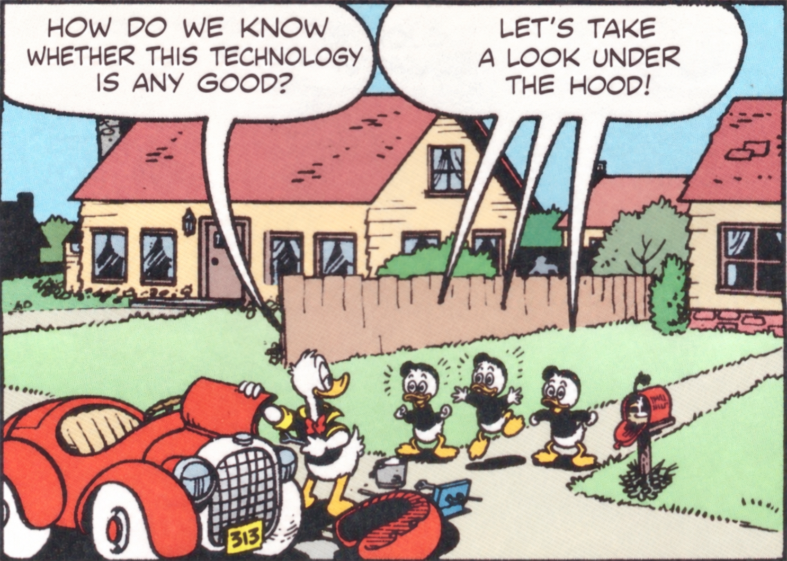

# Predicting human behavior with LLMs

LLMSS workshop · David Broska · 13 October 2026 · City University of Hong Kong

## Schedule

| Time | Session |
|---|---|
| 09:00–09:45 | Conceptual introduction. Predicting human behavior with LLMs and combining predictions with human responses in a mixed subjects design. |
| 09:45–10:00 | Practical demonstration. Estimate the same quantity using human responses, model predictions, and with a mixed subjects design. |
| 10:00–10:20 | Break and time to finish software setup. |
| 10:20–11:45 | Group work. Explain an example, adapt an analysis, or explore a question of your own. |
| 11:45–12:15 | Six group presentations, five minutes each. |
| 12:15–12:30 | General discussion and next steps. |

The session time follows the [conference programme](https://www.eps-academic.org/ai-conference). 

## Looking under the hood



When do LLMs succeed in predicting experimental treatment effects, and when do they fail?

This is our common question across all three archives. We compare the effects of the same treatments on human and model responses.

We will look closely at three research archives. Each contains model predictions and observed human results. We will examine what changes when we choose a different outcome, treatment, group of people, or measure of accuracy. Example questions include:

- Can a model get the average right while predicting individuals poorly?
- Can it rank treatments correctly but exaggerate their effects?
- Does an informative prediction help us estimate a treatment effect more precisely?
- What do we learn when a result holds for one outcome but fails for another?

## Three ways to participate

### Explain an example

- I will walk us through an analysis using the data by Peng et al. (2026). You can take a closer look at the notebooks by Ashokkumar et al. or Cui et al.
- Explain the treatment, the outcome, how the model predictions were made, and what one result tells us.
- You can present the rendered notebook (.ipynb), walking through its text, tables and plots. No new code, analysis or separate slides are needed.

### Adapt an analysis

- Start with a worked example and its prepared data.
- Compare model predictions with observed human responses or effects.
- For an example with paired responses, you can compare estimates using human responses alone, predictions alone, or a mixed subjects design.
- Change one part of the analysis. Try another outcome, treatment comparison, or dataset.
- Aim for one clear result. An unexpected result or an error you have not resolved is also worth discussing.

### Open exploration

- Choose a question of your own using the archives by Ashokkumar et al., Peng et al., or Cui et al.
- Look across an archive, compare models, or investigate one study in more detail.
- You might examine where predictions are accurate, whether a different accuracy measure changes the conclusion, or which kinds of outcomes are most predictable.
- Archive analyses can describe patterns across studies. A formal meta-analysis also needs to account for uncertainty and dependence between estimates.

Work in groups of six. With 36 participants, we will have six groups. Each group has five minutes to share. A few bullet points and one plot or table are enough. Share the question, one result, one limitation, and what you would try next. No polished presentation is expected.

## Choose an archive

| Archive | What you can compare | A useful starting point |
|---|---|---|
| [Ashokkumar et al. (2026)](data/workshop/ashokkumar/README.md) | Observed and predicted experimental effects, plus a prepared response-level example | Does information about racial discrimination change perceptions and support for pro-Black policies? Start with Haaland and Roth. |
| [Peng et al. (2026)](data/workshop/peng/README.md) | Human responses and the corresponding digital twin responses | Does predictive accuracy change across outcomes in the same study? The guided example compares gratitude and downstream outcomes. |
| [Cui et al. (2025)](data/workshop/cui/README.md) | Human and model effect estimates from psychology and management experiments, not individual responses | Does the model capture both the direction and size of an effect? |


## Getting started

Bring a laptop with Python and a way to open Jupyter notebooks. We will work from this GitHub repository. All data and existing predictions needed for the three notebooks are included. No API key or paid model account is needed.

1. On this repository’s GitHub page, choose **Code → Download ZIP** and unzip the downloaded folder. Alternatively, clone it with Git:

   ```bash
   git clone https://github.com/davidbroska/llm-human-behavior-workshop.git
   cd llm-human-behavior-workshop
   ```
2. Keep the whole folder together. Open a terminal in that folder, where you can see `README.md` and `requirements.txt`.
3. Install the packages and open JupyterLab:

   ```bash
   python -m pip install -r requirements.txt
   python -m jupyterlab
   ```

   On macOS or Linux, use `python3` if `python` is unavailable. On Windows, `py` may be the command. If you use Anaconda, run these commands in Anaconda Prompt. Python 3.11–3.13 is the intended setup; the notebooks were checked with Python 3.13.
4. In JupyterLab, open a notebook from `notebooks/`. Select a Python kernel from the environment where you installed the packages. Run the analysis cells in order with **Shift+Enter**. The optional installation cell is for a notebook using a different environment.

The first package installation needs internet access. After setup, the exercises use local files and make no model calls. If installation asks you to restart the kernel, restart it and run the analysis cells again. VS Code or an existing Jupyter installation is also fine.

- [Ashokkumar et al.](notebooks/01_ashokkumar.ipynb) · Haaland and Roth’s information treatment. This is the demonstration example.
- [Peng et al.](notebooks/02_peng.ipynb) · Gratitude and downstream outcomes.
- [Cui et al.](notebooks/03_cui.ipynb) · Ames and Mason’s catering negotiation.

Saved tables and plots are included. You can open the rendered .ipynb on GitHub or in Jupyter and use it directly for your presentation, even if you do not run new code. Coding agents are optional helpers for exploration and preparing presentations.

## Where the files are

| Folder or file | Purpose |
|---|---|
| `notebooks/` | The three participant notebooks, including saved results |
| `data/workshop/` | Ready-to-use data, one folder and a data guide per archive |
| `scripts/workshop_helpers.py` | PPI functions used by the notebooks for Ashokkumar et al. and Peng et al. |
| `scripts/load_cui.py` | Optional loader for original source downloads from Cui et al.; not needed to run the notebook |
| `scripts/prepare_*.py` | Optional scripts documenting how extracts were made; participants do not need to run these |
| `requirements.txt` | Packages for running the notebooks |

**Do not unpack the data files.** Pandas reads the `.csv.gz` file for Ashokkumar et al. directly. The archive example for Peng et al. reads tables inside its ZIP with Python. Only the repository ZIP downloaded from GitHub needs to be unzipped. The data guides explain columns, sources and which further analyses need additional source files.

The archive by Ashokkumar et al. includes wider response-level and effect comparisons. The archive by Peng et al. includes the default outcome tables for all 19 studies, but the prepared treatment assignments cover the gratitude and green-energy examples; additional experimental comparisons need the original source files. The archive by Cui et al. supports comparisons of aggregate effects, not participant-level PPI.

## Literature

- Broska, D., Howes, M., & van Loon, A. (2025). *The mixed subjects design: Treating large language models as potentially informative observations*. Sociological Methods & Research. [Published article](https://doi.org/10.1177/00491241251326865) · [Preprint](https://papers.ssrn.com/sol3/papers.cfm?abstract_id=5133034).
- Ashokkumar et al. (2026). *Large language models can predict the results of social science experiments*. Nature. [Published article](https://doi.org/10.1038/s41586-026-10742-x) · [Data and code](https://codeocean.com/capsule/9843791/tree/v1).
- Peng et al. (2026). *Digital twins are funhouse mirrors: Five systematic distortions*. Science Advances. [Published article](https://doi.org/10.1126/sciadv.aeh8260) · [Data and code](https://huggingface.co/datasets/LLM-Digital-Twin/Twin-2K-500-Mega-Study).
- Cui et al. (2025). *Can large language models replace human subjects? A large-scale replication of scenario-based experiments in psychology and management*. arXiv, version 3. [Preprint used in this workshop](https://arxiv.org/abs/2409.00128v3) · [Data and code](https://osf.io/j6wmn/).
